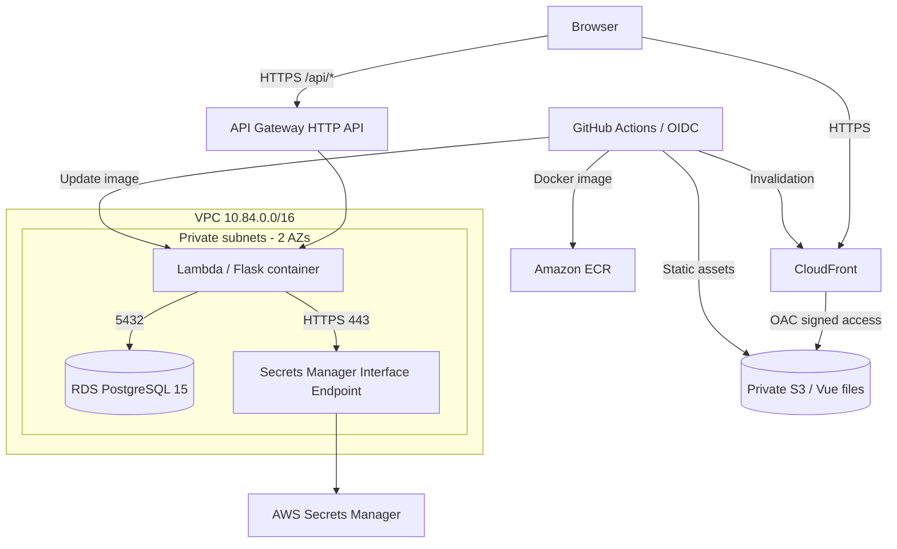

# NASE-842 — AWS Infrastructure as Code

**Terraform / AWS | VPC + RDS + Lambda + API Gateway + S3 + CloudFront | GitHub OIDC**

This repository defines the AWS infrastructure supporting **NASE-842**, a full-stack RealWorld blogging application deployed for a DevOps final assessment. The Vue frontend and Flask backend are adapted from existing open-source RealWorld implementations; this repository documents the cloud infrastructure, security boundaries, and automated delivery added for the assessment.

| Component | Link |
| --- | --- |
| Live application | https://realworld.eldeeb-o-skillup.vertexlab.net |
| Live API | https://api.realworld.eldeeb-o-skillup.vertexlab.net |
| Frontend source | [nase842-frontend](https://github.com/OmarElDeeb-exe/nase842-frontend) |
| Backend source | [nase842-backend](https://github.com/OmarElDeeb-exe/nase842-backend) |
| Region | **us-east-1** |

## Architecture



**Request path:** CloudFront serves the frontend from a private S3 bucket; the browser separately calls the API Gateway domain. API Gateway invokes the Flask Lambda container via the Lambda Web Adapter. Flask queries private PostgreSQL and retrieves runtime secrets through a VPC endpoint.

## AWS services and Terraform files

| Area | Terraform definitions | Role |
| --- | --- | --- |
| Network | `network.tf`, `security-groups.tf` | Dedicated VPC, private subnets, Lambda-to-RDS access on TCP 5432 |
| Database | `rds.tf`, `rds-instance.tf` | RDS PostgreSQL 15 with encrypted storage and managed master password |
| Secrets | `jwt-secret.tf`, `jwt-access.tf`, `lambda-secrets-policy.tf`, `secrets-endpoint.tf` | JWT secret resource, access policies, private connectivity to Secrets Manager |
| Compute + registry | `main.tf`, `lambda.tf`, `lambda-vpc-policy.tf` | ECR image registry and VPC-connected Lambda |
| API | `api-gateway.tf`, `api-app-route.tf`, `api-domain.tf` | HTTP API, Flask proxy route, custom HTTPS domain |
| Frontend | `frontend-s3.tf`, `frontend-cloudfront.tf`, `frontend-dns.tf` | Private S3, CloudFront OAC, DNS |
| HTTPS | `realworld-acm.tf` | ACM certificate and DNS validation |
| CI/CD IAM | `github-frontend-iam.tf`, `github-backend-iam.tf` | Per-repository OIDC trust and deployment permissions |

### Network and security details

- VPC CIDR: **10.84.0.0/16**.
- Private subnet A: **10.84.1.0/24** in `us-east-1a`; subnet B: **10.84.2.0/24** in `us-east-1b`.
- Lambda connects to RDS on port **5432** only through security-group rules; RDS is **not publicly accessible**.
- Lambda retrieves AWS Secrets Manager values over HTTPS through a **private interface endpoint**; no NAT gateway is required for this particular database/secret access path.
- CloudFront accesses the S3 origin using **Origin Access Control (OAC)**; public bucket access is blocked.
- GitHub Actions obtains short-lived AWS credentials using **OIDC**, scoped to the relevant repository and `main` branch.

## Prerequisites

- Terraform **>= 1.10** and AWS provider **~> 6.0** (see `main.tf` and `.terraform.lock.hcl`).
- AWS CLI authenticated to the **authorized AWS account** in `us-east-1`, with permission to manage only the resources for this assessment.
- An AWS Route 53 hosted zone appropriate for the two custom domains.
- Docker and access to the backend source to **build and publish the initial ECR image**.
- A secure, nonempty JWT signing key stored as a **Secrets Manager secret value**, not committed in a Terraform variable or source file.

**Important:** this project was implemented in a **shared skill-up AWS account**. It is not a generic one-command installation for a different AWS account: several domain, hosted-zone, account, and IAM identifiers are explicitly configured. Review them before reusing the code. Never apply changes to shared infrastructure without explicit authorization.

## Terraform workflow

From a checkout of this repository:

```bash
git clone https://github.com/OmarElDeeb-exe/nase842-infra.git
cd nase842-infra

# Authenticate using your authorized AWS profile first.
export AWS_PROFILE=task17
export AWS_REGION=us-east-1

terraform init
terraform fmt -check
terraform validate
terraform plan
```

`terraform plan` is a **read-only review of proposed infrastructure changes**. The repository intentionally excludes `*.tfstate`, `*.tfvars`, and private keys. If you do not have the existing project state and the appropriate backend configuration, Terraform may propose creating resources that already exist. **Do not run `terraform apply` based only on a fresh checkout.**

### Deployment / bootstrap ordering

There is a bootstrap dependency between infrastructure and application artifacts:

1. Provision prerequisite AWS networking, roles, ECR, database, security policies, TLS/DNS, and secret resources in a controlled Terraform workflow.
2. Build the backend Lambda image from [Dockerfile.lambda](https://github.com/OmarElDeeb-exe/nase842-backend/blob/main/Dockerfile.lambda), push the **initial `v5` image tag** to ECR, and make sure the JWT secret **has a securely generated value**. The Terraform Lambda configuration initially references `:v5`.
3. Finish provisioning the Lambda function, API Gateway integration and frontend S3/CloudFront resources.
4. Apply database migrations securely (Alembic); they are **not performed by Terraform**.
5. Deploy application code using the frontend/backend GitHub Actions workflows and verify the HTTPS endpoints.

The actual first deployment was assembled in stages. These steps describe prerequisites and **do not claim that `terraform apply` alone recreates every runtime artifact**.

Terraform has `lifecycle { ignore_changes = [image_uri] }` for the Lambda image because **GitHub Actions** deploys subsequent image versions. As a result, a clean Terraform plan does not prove the currently deployed image corresponds to the image tag appearing in `lambda.tf`.

## Deployment pipelines

- [Frontend workflow](https://github.com/OmarElDeeb-exe/nase842-frontend/blob/main/.github/workflows/deploy.yml): install pnpm dependencies, build `dist/`, authenticate via GitHub OIDC, sync S3 assets, upload no-cache `index.html`, invalidate CloudFront.
- [Backend workflow](https://github.com/OmarElDeeb-exe/nase842-backend/blob/main/.github/workflows/deploy.yml): assume AWS role with OIDC, build an `linux/amd64` container image, push an immutable uniquely tagged image to ECR, update Lambda, wait for deployment success, and smoke-test the API endpoint.

These pipelines perform **build and deployment checks**. The full unit/integration test suites are not currently gated by the production deployment workflows.

## Verify the running project (non-destructive)

```bash
# DNS, HTTPS, and static frontend
curl -fsS -o /dev/null -w 'Frontend HTTP %{http_code}\n' \
  https://realworld.eldeeb-o-skillup.vertexlab.net/

# Serverless backend
curl -fsS https://api.realworld.eldeeb-o-skillup.vertexlab.net/api/ping

# Dynamic endpoints
curl -fsS https://api.realworld.eldeeb-o-skillup.vertexlab.net/api/tags
curl -fsS https://api.realworld.eldeeb-o-skillup.vertexlab.net/api/articles

# IAM identity / function configuration (requires AWS read permissions)
aws sts get-caller-identity
aws lambda get-function-configuration --function-name nase842-flask \
  --region us-east-1 \
  --query '{State:State,LastUpdateStatus:LastUpdateStatus,PackageType:PackageType}'
```

For an application-level demonstration, register a disposable user, log in, create an article, and reload it. Check the API Gateway/Lambda invocation path, CloudWatch logs, and database persistence. Only treat a test as proven once executed successfully.

## Cost and recovery tradeoffs

This is an **assessment environment**, not a high-availability production architecture. RDS is configured as Single-AZ, with one-day automated backup retention, deletion protection disabled, and no final snapshot on deletion. These were cost/simplicity tradeoffs; production recommendations include Multi-AZ where required, longer backups, restore testing, alerting, and deletion safeguards.

Additional implementation considerations:
- The Lambda package is a container image, not a ZIP deployment.
- A Secrets Manager interface endpoint incurs AWS cost.
- No long-lived AWS access keys need to be placed in GitHub Actions secrets for deployment.
- **Known application hardening item:** Flask currently initializes unrestricted CORS; the backend README documents this limitation.
- Resource names and domains are specific to this assessment; adapt deliberately before deploying elsewhere.

## Source attribution

The application uses the open-source [RealWorld specification](https://github.com/gothinkster/realworld), a [Vue frontend](https://github.com/mutoe/vue3-realworld-example-app), and a [Flask backend](https://github.com/mhegelheimer/realworld-flask). These original projects are credited in their respective repositories. The Terraform and AWS deployment integration documented here constitute the NASE-842 infrastructure work.
