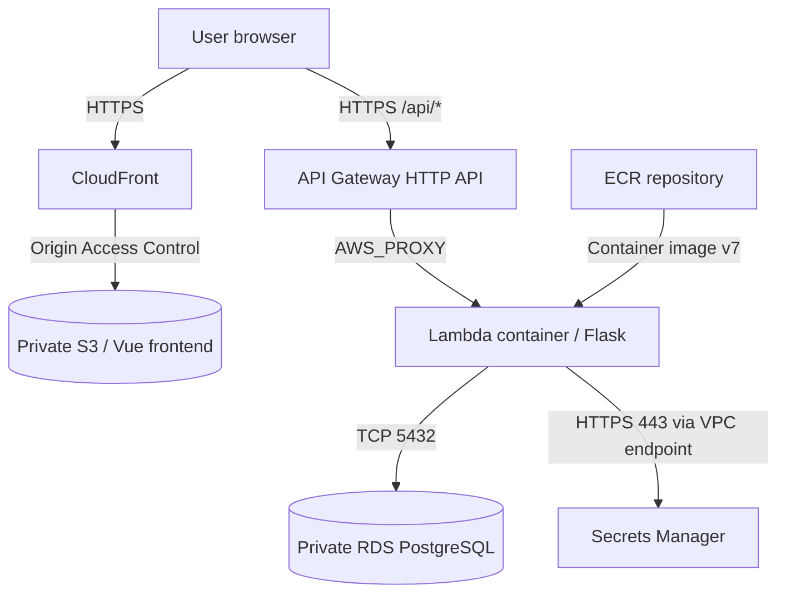

# NASE-842 — Ireland Infrastructure (eu-west-1)

This directory contains the **independent Ireland rebuild** of the NASE-842 RealWorld/Conduit application. The original **Virginia (us-east-1)** Terraform configuration remains at the repository root. Both environments use separate AWS resources and Terraform state; Ireland is **not** an automatic failover or a continuously replicated copy of Virginia.

The Ireland deployment was created and tested after changing the AWS region, VPC/subnet CIDRs, RDS instance class, frontend S3 bucket name, and AWS resource tags.

## Live environment

| Component | Ireland deployment |
| --- | --- |
| Region | `eu-west-1` (Ireland) |
| AWS account | `253650698585` (shared assessment account) |
| Website (HTTPS) | https://dvqn80eroo0tk.cloudfront.net |
| Backend API | https://ezes0o2ub8.execute-api.eu-west-1.amazonaws.com |
| API health check | https://ezes0o2ub8.execute-api.eu-west-1.amazonaws.com/api/ping |
| Lambda function | `nase842-flask` |
| Current Lambda image | `253650698585.dkr.ecr.eu-west-1.amazonaws.com/nase842-flask:v7` |
| CloudFront distribution | `E3TD8SX401FEWB` |
| Frontend S3 bucket | `nase842-frontend-rebuild-253650698585-eu-west-1` |
| RDS instance | `nase842-postgres` — PostgreSQL 15, `db.t4g.small` |

The CloudFront hostname is the default AWS-generated domain. No custom Ireland DNS name or ACM certificate has been configured. The URL after `/#/` is a frontend Vue Router route.

## Architecture



- **Frontend:** Vue 3/Vite compiled to static assets in private S3, delivered over HTTPS through CloudFront with Origin Access Control.
- **Backend:** Flask served by Gunicorn inside a Lambda-compatible Docker image, reached through API Gateway and the Lambda Web Adapter.
- **Database:** PostgreSQL in private subnets; application records persist in the Ireland RDS instance.
- **Authentication:** JWT signing key and RDS database credentials are retrieved from AWS Secrets Manager rather than committed to source.
- **Networking:** VPC `10.85.0.0/16`, private subnet A `10.85.1.0/24` (`eu-west-1a`), private subnet B `10.85.2.0/24` (`eu-west-1b`). RDS accepts PostgreSQL traffic from the Lambda security group; Lambda reaches Secrets Manager via an interface VPC endpoint.
- **Image registry:** Ireland ECR repository `nase842-flask` uses immutable image tags and scanning on push.

## Source repositories

- [Frontend — Vue application](https://github.com/OmarElDeeb-exe/nase842-frontend)
- [Backend — Flask API and tests](https://github.com/OmarElDeeb-exe/nase842-backend)
- [Infrastructure — Terraform](https://github.com/OmarElDeeb-exe/nase842-infra)

The Terraform resources in **this folder** target Ireland. The [repository root README](../README.md) and root Terraform files primarily document the original Virginia environment.

## Terraform file responsibilities

| Files | Purpose |
| --- | --- |
| `main.tf`, `.terraform.lock.hcl` | AWS provider, region, default tags, ECR |
| `network.tf`, `security-groups.tf` | VPC, private subnets, controlled Lambda/RDS network access |
| `rds.tf`, `rds-instance.tf` | Database subnet group and PostgreSQL snapshot restoration |
| `lambda.tf`, `lambda-vpc-policy.tf` | Lambda container, execution role, VPC permissions |
| `api-gateway.tf`, `api-app-route.tf` | HTTP API, Lambda integration, proxy routes |
| `frontend-s3.tf`, `frontend-cloudfront.tf` | Frontend bucket, OAC, CloudFront distribution |
| `jwt-secret.tf`, `jwt-access.tf`, `lambda-secrets-policy.tf`, `secrets-endpoint.tf` | Secret resource, IAM permissions, private endpoint |
| `github-backend-iam.tf`, `github-frontend-iam.tf` | Ireland-scoped OIDC deployment roles and permissions |

The backend includes both `GET /api/ping` and `ANY /api/{proxy+}` API Gateway routes.

## Database migration and independence

The Ireland RDS instance was restored from the manual snapshot `nase842-ireland-restore-20261030`, copied from the original Virginia database snapshot. This preserved the data at the time of restoration, allowing existing user accounts and articles to be tested after the rebuild.

**Important:** The two databases are independent. New articles, password changes, and other writes made after the snapshot in one region do **not** automatically appear in the other.

Ireland uses `db.t4g.small`, encrypted storage, private connectivity, and a Secrets Manager-managed master password. This is a cost-conscious single-AZ assessment setup, not a production high-availability database architecture.

## Application image and deployment status

The Ireland Lambda was verified running image **`v7`** after a backend user-settings/password update and a successful Lambda code update. The `image_uri` in `lambda.tf` references that deployed version.

```hcl
image_uri = "${aws_ecr_repository.flask.repository_url}:v7"

lifecycle {
  ignore_changes = [image_uri]
}
```

The lifecycle rule allows application image updates independently of Terraform. The image must already exist in **Ireland ECR** before creating a new Lambda from this configuration.

**Deployment distinction:** The existing frontend and backend GitHub Actions workflows still target the **Virginia** resources. The Ireland app assets and `v7` Lambda image were deployed separately. The Ireland-specific IAM roles have been provisioned, but **Ireland CI/CD workflows have not yet been configured and verified**. Do not trigger the current Virginia workflows expecting an Ireland deployment.

The frontend build for Ireland needs `VITE_API_HOST=https://ezes0o2ub8.execute-api.eu-west-1.amazonaws.com` so browser API calls target the correct regional API.

## Safe Terraform verification

The working Ireland state was maintained separately from the original Virginia state during the rebuild. Terraform state files, credentials, and secrets are intentionally **not committed** to GitHub.

A fresh checkout can validate configuration syntax:

```bash
cd terraform-eu-west-1
terraform init
terraform fmt -check
terraform validate
```

Formatting checks may identify existing style changes without indicating an infrastructure defect. **Do not run `terraform apply` or `terraform destroy` from a fresh checkout.** Without the existing Ireland Terraform state, Terraform can propose duplicate resource creation or destructive changes. Review a plan only from the appropriate working directory with the correct state and AWS credentials.

Moving these resources into reusable Terraform modules would change Terraform resource addresses; that refactor requires explicit state movement/moved blocks and a carefully inspected plan before any apply.

## Functional verification

The following flows were previously verified on the Ireland deployment:

- Website loads over HTTPS; browser requests reach the Ireland API.
- Existing users restored from the snapshot can log in.
- New articles can be published and read from the Ireland database.
- Password update flow works: the old password is rejected and the new password is accepted.
- API Gateway/Lambda responds on `/api/ping`.

For a final assessment, repeat tests with a **disposable** account and confirm the API endpoint and browser network requests point to Ireland. Do not share passwords, JWTs, or Secrets Manager secret values in screenshots.

## Scope and known tradeoffs

- This assessment uses a shared AWS account; region-specific names, IAM roles, snapshot identifiers, and bucket names should not be blindly reused elsewhere.
- No cross-region automatic failover or live RDS replication is configured.
- The Ireland frontend uses the default CloudFront domain rather than a custom hostname.
- The backend still initializes permissive CORS; a production deployment should restrict allowed origins.
- Resource naming, RDS backup settings, and environment hardening should be reviewed separately before production use.

**Virginia remains independent:** no part of this README or the Ireland `lambda.tf` image-reference update requires modifying the original us-east-1 deployment.
