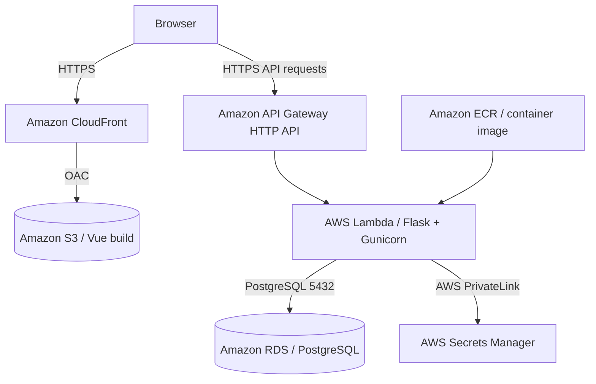

# NASE-842 — Ireland Infrastructure

**Region:** `eu-west-1` (Ireland)  
**Project:** RealWorld / Conduit — Vue frontend, Flask API, PostgreSQL, Terraform and AWS

This directory contains the independent Ireland rebuild of the NASE-842 application. The Terraform configuration at the [repository root](../README.md) represents the original `us-east-1` environment. The Ireland and Virginia deployments have separate infrastructure and Terraform state.

## Deployment endpoints

| Component | Ireland environment |
| --- | --- |
| Website | https://dvqn80eroo0tk.cloudfront.net |
| HTTP API | https://ezes0o2ub8.execute-api.eu-west-1.amazonaws.com |
| API health check | https://ezes0o2ub8.execute-api.eu-west-1.amazonaws.com/api/ping |
| Lambda function | `nase842-flask` |
| Lambda container image | Immutable CI/CD image tag (latest verified run listed below) |
| CloudFront distribution ID | `E3TD8SX401FEWB` |
| Frontend S3 bucket | `nase842-frontend-rebuild-253650698585-eu-west-1` |
| RDS instance | `nase842-postgres` (`db.t4g.small`) |

The website uses the standard CloudFront HTTPS hostname. Vue Router handles the `/#/` application paths.

## Architecture



- **Frontend:** Vue 3 and Vite static build, served through CloudFront from an S3 origin using Origin Access Control.
- **Backend:** Python/Flask application packaged as an `x86_64` Lambda container image. The Lambda Web Adapter passes API requests to Gunicorn/Flask.
- **Database:** PostgreSQL on Amazon RDS, deployed in private subnets.
- **Configuration:** AWS Secrets Manager provides the database credentials and JWT signing key used by the backend.

## Configuration and versions

These values come from the checked-in Terraform and application build definitions; they are not claims about every independently installed runtime package.

| Component | Configuration |
| --- | --- |
| AWS region | `eu-west-1` |
| Terraform requirement | `>= 1.10.0` |
| AWS Terraform provider | `~> 6.0`; lockfile selects `6.71.0` |
| Terraform baseline image | `v7` (image changes managed separately from Terraform) |
| Backend base image | `python:3.11-slim-bookworm` |
| Lambda Web Adapter | `1.1.0` |
| Gunicorn | `25.3.0` in the backend Dockerfile |
| PostgreSQL | `15.19` configured in Terraform |
| RDS instance class | `db.t4g.small` |
| VPC | `10.85.0.0/16` |
| Private subnet A | `10.85.1.0/24` (`eu-west-1a`) |
| Private subnet B | `10.85.2.0/24` (`eu-west-1b`) |

The Ireland database was restored from a snapshot of the original environment. Both regions operate independently; changes made to one database after restoration are not automatically synchronized with the other.

## Terraform organization

| Configuration | Purpose |
| --- | --- |
| `main.tf`, `.terraform.lock.hcl` | AWS provider, region, common tags and ECR |
| `network.tf`, `security-groups.tf` | VPC, subnets and network access rules |
| `rds.tf`, `rds-instance.tf` | RDS subnet group and restored database |
| `lambda.tf`, `lambda-vpc-policy.tf` | Lambda image, runtime settings and IAM |
| `api-gateway.tf`, `api-app-route.tf` | HTTP API and Lambda integration |
| `frontend-s3.tf`, `frontend-cloudfront.tf` | Frontend object storage and CDN |
| `jwt-secret.tf`, `jwt-access.tf`, `lambda-secrets-policy.tf`, `secrets-endpoint.tf` | Secrets Manager connectivity and access |
| `github-frontend-iam.tf`, `github-backend-iam.tf` | Regional GitHub OIDC deployment roles |

The API exposes a health-check route (`GET /api/ping`) and an application proxy route (`ANY /api/{proxy+}`).

## Application deployment

The original Ireland backend was deployed as image **`v7`**. The successful Ireland backend pipeline run on **2026-11-02** subsequently deployed image tag **`b45e40a96280c24c24c672f32278b11a01426540-41422557063-1`** (verified from the workflow logs). The Terraform configuration retains the `v7` bootstrap reference:

```hcl
image_uri = "${aws_ecr_repository.flask.repository_url}:v7"
```

The Lambda resource uses `lifecycle { ignore_changes = [image_uri] }` so later CI/CD deployments use their own immutable image tags without changing the Terraform configuration. The `image_uri` in Terraform is not expected to match the live Lambda image after a pipeline deployment.

The frontend was built with the Ireland API endpoint:

```bash
VITE_API_HOST=https://ezes0o2ub8.execute-api.eu-west-1.amazonaws.com pnpm build
```

The original GitHub Actions workflows continue to deploy to `us-east-1`. Dedicated **manual** Ireland workflows have been added, leaving the Virginia workflows unchanged:

- [Ireland backend deployment](https://github.com/OmarElDeeb-exe/nase842-backend/blob/main/.github/workflows/deploy-ireland.yml)
- [Ireland frontend deployment](https://github.com/OmarElDeeb-exe/nase842-frontend/blob/main/.github/workflows/deploy-ireland.yml)

These Ireland workflows use explicit `workflow_dispatch` triggers on the `main` branch. Both were executed successfully on **2026-11-02**: [backend run #1](https://github.com/OmarElDeeb-exe/nase842-backend/actions/runs/41422557063) and [frontend run #1](https://github.com/OmarElDeeb-exe/nase842-frontend/actions/runs/41422849708).

## Verification

The following user flows were checked after the Ireland deployment:

- The site loads via CloudFront and sends application requests to the Ireland API.
- Existing accounts from the restored database can authenticate.
- Articles can be published and read after the rebuild.
- A password change was verified against the Ireland deployment: the previous password was rejected and the new password was accepted.
- Lambda image `v7` reached the `Active` / `Successful` update status.

For quick **read-only** endpoint checks:

```bash
curl -fsS https://ezes0o2ub8.execute-api.eu-west-1.amazonaws.com/api/ping
curl -fsS https://ezes0o2ub8.execute-api.eu-west-1.amazonaws.com/api/articles
```

## Working with Terraform

This GitHub folder contains the infrastructure **source**, not the existing Ireland Terraform state. The deployed state is stored separately and is not committed here.

To initialize and validate source from a fresh checkout without connecting to a state backend:

```bash
cd terraform-eu-west-1
terraform init -backend=false
terraform validate
```

**Use the correct existing Ireland state before running a deployment plan or apply.** Do not apply from an empty state against resources that already exist. The original Virginia environment should be managed using its own state and configuration.

## Related repositories

- [Frontend source](https://github.com/OmarElDeeb-exe/nase842-frontend)
- [Backend source](https://github.com/OmarElDeeb-exe/nase842-backend)
- [Infrastructure repository](https://github.com/OmarElDeeb-exe/nase842-infra)
